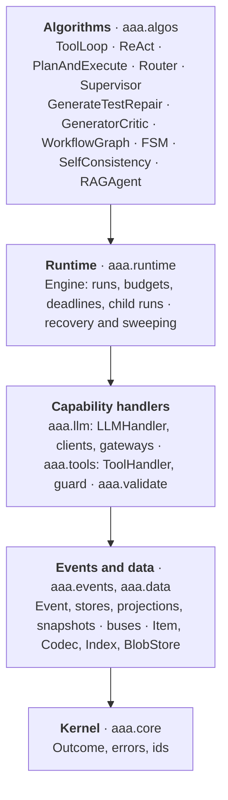
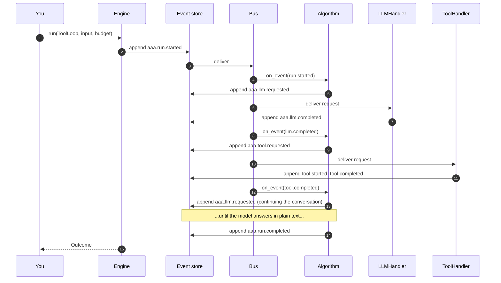

# Architecture

AAA is a stack of layers. Each layer depends only on the ones below it.

| Package | Responsibility |
|---|---|
| `aaa.core` | `Outcome`/`OutcomeKind`, the error base classes, time-sortable and deterministic ids. |
| `aaa.events` | The `Event` envelope, event stores (memory, SQLite, Postgres, Redis), buses (in-process, distributed, client), projections and snapshots, schema registry, CloudEvents conversion, execution guards. |
| `aaa.data` | `Item`, codecs, blob stores (claim-check), the retrieval `Index`, capability protocols. |
| `aaa.llm` | The `LLMClient` protocol, the OpenAI-compatible client, gateway presets, LiteLLM adapter, retry and circuit-breaker wrappers, streaming, fake and replay clients, `LLMHandler`. |
| `aaa.tools` | `@tool`, `ToolRegistry`, `ToolHandler`, the execution guard, a retrieval tool. |
| `aaa.validate` | Deterministic validators and `ValidationHandler`. |
| `aaa.runtime` | `Engine`, `RunHandle`, `Budget`, recovery. |
| `aaa.algos` | The algorithms. |

## A request, end to end

Three rules hold throughout:

1. **Append before deliver.** An event is written to the store *before* any handler sees it. The log is therefore
   always at least as new as anything that has acted on it.
2. **One serial queue per algorithm.** An algorithm sees its events strictly in log order, so state folded from
   the log is always consistent with what it is handling.
3. **Handlers return events; the engine persists them.** A handler never writes the log directly and never raises
   across the bus. An exception in an algorithm fails *that run* (as an event) and never the bus.

## Single process and cluster use the same code

With `InProcessBus` (the default) delivery is an in-memory queue. With `DistributedBus` the same events travel
through a partitioned log in Postgres or Redis, consumed by competing workers. Algorithms, tools and handlers are
identical; only the `Engine(store=..., bus=...)` line changes. See [Running a cluster](../guides/clusters.md).

## What is deliberately not here

- **No hidden state.** There is no per-run Python object holding a conversation. If you find yourself wanting one,
  you want a [projection](projections-and-snapshots.md).
- **No framework for building prompts.** AAA decides *what happens next*; how you phrase a system prompt is yours.
- **No agent "memory" product.** Anything an algorithm remembers is in the log and its projections.
