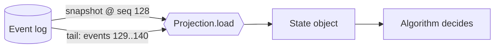

# Projections and snapshots

An algorithm holds no state of its own. When an event arrives, it asks for the run's *projection*: state computed by
folding the run's events.



## Writing a projection

A projection is an initial state, a fold function, and (to enable snapshots) a name and state type.

```python
from pydantic import BaseModel, Field
from aaa.events import Event, Projection


class Translations(BaseModel):
    wanted: list[str] = Field(default_factory=list)
    done: dict[str, str] = Field(default_factory=dict)


def apply(state: Translations, e: Event) -> Translations:
    if e.type == "aaa.run.started":
        state.wanted = e.data["input"]["languages"]
    elif e.type == "aaa.llm.completed":
        state.done[e.data["tag"]] = e.data["response"]["message"]["content"]
    return state  # mutate-and-return is fine: the state object is private


TRANSLATIONS = Projection(
    Translations,
    apply,
    name="acme.translations",  # unique snapshot key
    version=1,  # bump when the fold or state shape changes
    state_type=Translations,  # how to (de)serialize the state
    every=64,  # snapshot after this many events were folded
)
```

In an algorithm: `state = await ctx.project(TRANSLATIONS)`.

Rules for a fold:

- **Deterministic.** Same events in, same state out. No clocks, randomness or I/O.
- **Total.** Ignore event types you do not care about.
- **Compact.** The state is serialized to JSON on every snapshot; do not accumulate unbounded data in it.
  Store ids, counters and the last request id, not transcripts.

## How snapshots work

`Projection.load` does:

1. Load the latest snapshot for `(stream, name)` if one exists, its `version` matches, and its `seq` is not ahead of the log.
2. Read only the events after the snapshot's `seq` and fold them.
3. If at least `every` events were folded, save a new snapshot at the latest `seq`.

Snapshots are **derived data**, so every failure degrades to a replay instead of an error:

| Situation | Result |
|---|---|
| No snapshot | Replay from event 0. |
| Corrupt JSON | Ignored (logged), replay. |
| `version` mismatch (you changed the fold) | Ignored, replay. |
| `seq` ahead of the log (stale/foreign) | Ignored, replay. |
| Two workers save simultaneously | Saves are monotonic by `seq`; an older snapshot never overwrites a newer one. |

All four stores (memory, SQLite, Postgres, Redis) implement snapshots.

## What it buys you

A 40-turn tool loop, folding with and without snapshots (every=8):

| | State folds |
|---|---|
| No snapshots | 6,724 |
| Snapshots | 407 |

The gap grows with run length: without snapshots every handled event refolds the whole history (quadratic); with them
it folds only the tail. This, together with [delta requests](../operations/performance.md#long-conversations),
keeps long runs linear.

## Built-in projections

| Projection | State | Used by |
|---|---|---|
| `aaa.algos.loops.LOOP` | request id, turn count, pending tool calls and results | `ToolLoop`, `ReAct` |
| `aaa.algos.refine.REFINE` | last request id, candidate, iteration count | `GenerateTestRepair`, `GeneratorCritic` |
| `aaa.algos.plan.PLAN` | steps, statuses, results, replan count | `PlanAndExecute` |
| `aaa.algos.control.WF`, `FSM_STATE` | node results; FSM path | `WorkflowGraph`, `FSM` |
| `aaa.algos.ensemble.SAMPLES` | raw samples and failure count | `SelfConsistency` |
| `aaa.runtime.engine.RUNMETA` | spend, completion, open children | the engine itself |

Because the engine's own view of a run is a projection too, any process can adopt any run: that is what makes
[clusters](../guides/clusters.md) possible.
