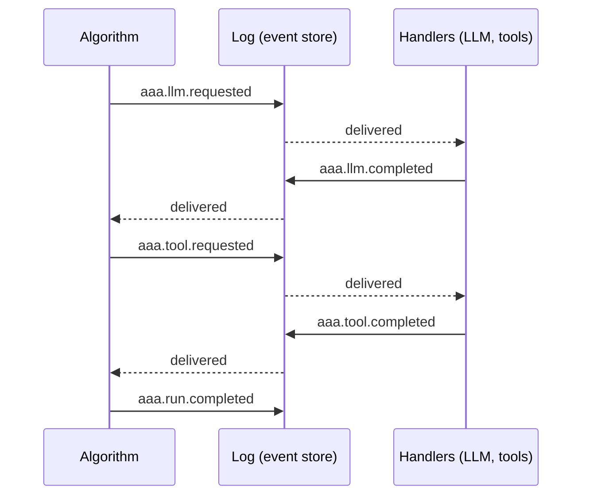

# The mental model

Five ideas explain almost everything in AAA. If something surprises you later, one of these will explain it.

## 1. A run is a list of events

When you start an algorithm, the engine appends `aaa.run.started` to a stream named after the run. Everything that
happens afterwards (an LLM was asked, a tool was called, a plan was made, the run finished) is another event
appended to that stream. Events are immutable. Nothing is ever updated in place.

## 2. State is a fold of the log

An algorithm does not keep variables between events. When an event arrives it asks the engine for the run's
*projection*: a small state object computed by folding the events so far (optionally from a snapshot, so it costs
only the new events). It decides what to do from that state and returns new events.

This is why a run can be resumed after a crash, replayed in a test, audited after an incident, or continued by a
different process: the only thing that matters is the log.

## 3. Capabilities are handlers; failures are events

Calling a model or running a tool is not a function call inside the algorithm. The algorithm emits
`aaa.llm.requested` or `aaa.tool.requested`; a *handler* (`LLMHandler`, `ToolHandler`) performs the work and emits
`...completed` or `...failed`. A failed LLM call or a crashing tool becomes a fact on the log that the algorithm
reads and decides about (retry? explain to the model? give up?). Exceptions never cross the bus.

## 4. The engine enforces the limits, not the algorithm

Budgets, deadlines, cancellation, approval gates, tool timeouts and tool concurrency pools are enforced by the
`Engine` and the handlers. A misbehaving model cannot talk its way past them, because they are not in the prompt.

Every run ends in exactly one of seven [outcomes](../reference/outcomes-and-errors.md), and those are distinct on
purpose: `success`, `no_solution`, `timeout`, `budget_exceeded`, `invalid_input`, `cancelled`, `failed`.

## 5. Delivery is at-least-once, so everything is idempotent

Messages can be delivered more than once (after a crash, after a worker stalls). AAA makes that safe by
construction: events derived from other events get *deterministic ids*, so deriving the same event twice is
absorbed by the store; every request has exactly one result id; algorithms decide from state rather than from "the
event that just arrived". Side effects in *your* tools are the one place you must take care. The
[tool execution guard](../guides/tool-guard.md) gives you the machinery.

!!! note "Where each idea lives"
    | Idea | Code |
    |---|---|
    | events and the log | `aaa.events` (`Event`, `EventStore`, `InProcessBus`, `DistributedBus`) |
    | projections and snapshots | `aaa.events.Projection`, `Ctx.project` |
    | handlers | `aaa.llm.LLMHandler`, `aaa.tools.ToolHandler`, `aaa.validate.ValidationHandler` |
    | engine and limits | `aaa.runtime.Engine`, `Budget` |
    | idempotency and the guard | deterministic ids, `aaa.tools.GuardConfig` |
