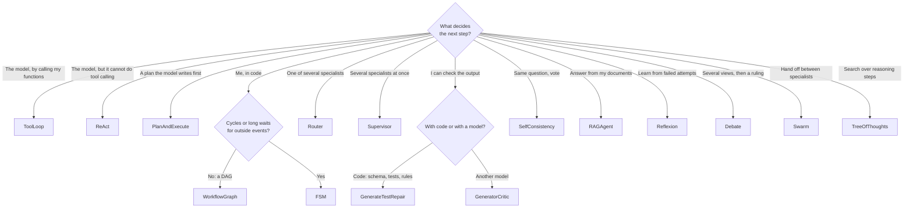

# Choosing an algorithm

All algorithms share one contract (an event-in, events-out function over projected run state), so they compose: a
`PlanAndExecute` executes steps with a `ToolLoop`, a `Router` delegates to any algorithm, a `Supervisor` coordinates
several. Start from the simplest one that fits.

## At a glance

| Algorithm | Control flow decided by | LLM calls | Key knobs | Result `value` |
|---|---|---|---|---|
| [`ToolLoop`](tool-loop-react.md) | the model | 1 per turn | `max_turns`, `tool_names`, `system`, `stream` | `{"text", "turns"}` |
| [`ReAct`](tool-loop-react.md) | the model (text protocol) | 1 per turn | same | `{"text", "turns"}` |
| [`PlanAndExecute`](plan-and-execute.md) | model plans, code schedules | plan + per-step + synthesis | `executor`, `max_parallel`, `max_replans`, `synthesize` | `{"text", "results"}` |
| [`Router`](router-supervisor.md) | rules, then optionally the model | 0 or 1 | `classifier`, `default`, routes | the chosen child's value |
| [`Supervisor`](router-supervisor.md) | the model, via delegate tools | per turn + workers | `workers`, `extra_tools` | `{"text", "turns"}` |
| [`GenerateTestRepair`](refine.md) | your validator | 1 per attempt | `validator`, `max_iterations` | `{"candidate", "iterations"}` |
| [`GeneratorCritic`](refine.md) | a critic model | 2 per attempt | `critic_model`, `max_iterations` | `{"candidate", "iterations"}` |
| [`WorkflowGraph`](workflow-fsm.md) | your DAG | 0 | nodes, `output` | the output node's result |
| [`FSM`](workflow-fsm.md) | your transition table + events | 0 | `transitions`, `terminal`, `on_enter` | `{"state", "path"}` |
| [`SelfConsistency`](ensembles-rag.md) | vote | `n` in parallel | `n`, `temperature`, `extract` | `{"answer", "votes", "samples", "agreement"}` |
| [`RAGAgent`](ensembles-rag.md) | the model | per turn | `index`, `k` | `{"text", "turns"}` |
| [`Reflexion`](reasoning.md) | your validator or a critic | attempt + evaluation + reflection per trial | `validator`, `max_trials` | `{"candidate", "trials", "reflections"}` |
| [`Debate`](reasoning.md) | vote or a judge | `agents * (rounds + 1)` (+1) | `agents`, `rounds`, `judge`, `personas` | `{"answer", "rounds", "agents", "answers", "judged"}` |
| [`Swarm`](reasoning.md) | the model, via transfer tools | per turn | `agents`, `start`, `max_handoffs` | `{"text", "turns", "agent", "handoffs"}` |
| [`TreeOfThoughts`](reasoning.md) | scores, in code | up to `2 * depth * width * branching` | `depth`, `width`, `branching`, `stop_score` | `{"answer", "score", "path", "depth", "explored"}` |

## Rules of thumb

- **Prefer determinism you can have.** If the steps are known, a `WorkflowGraph` is cheaper, faster and more
  predictable than asking a model to rediscover them. Use the LLM where judgement is needed and code elsewhere.
- **Verify with code before verifying with a model.** `GenerateTestRepair` with a real check (a schema, a unit test,
  a business rule) beats `GeneratorCritic` whenever you *can* write the check.
- **Voting is for exact answers.** `SelfConsistency` helps when answers can be compared (numbers, labels, extracted
  fields). It does not help with free-form prose.
- **Plans cost latency.** `PlanAndExecute` pays for planning and synthesis calls. It earns that back when steps run in
  parallel or are long; for a two-tool task a `ToolLoop` is better.
- **Cap everything.** Give every algorithm a `Budget`, and `max_turns`/`max_iterations` where offered. Loops that can
  run forever eventually will.

## Common to all

- Input is a dict. The built-ins read `task` (a string); `ToolLoop`/`ReAct` also accept `messages` (a full message list
  in the `Message` shape) for complete control of the starting conversation.
- Pass `model=` to choose a model per algorithm, and `params={"temperature": 0, ...}` for request parameters.
- Each algorithm's `name` must be **unique** within an engine's cluster (it is how runs are routed). `ToolLoop(..., name="billing")`
  renames an instance.
- Every outcome kind is possible; see [Outcomes and errors](../../reference/outcomes-and-errors.md).
