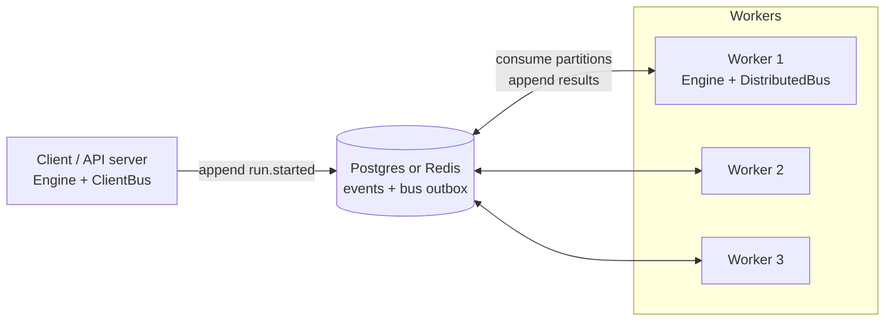

# Running a cluster

Run the same worker process on several machines against one **Postgres** (or **Redis**) database. Runs are spread across
workers, and when a worker dies another finishes its work.



## The worker

```python
--8<-- "examples/cluster_worker.py"
```

Every worker runs **identical code**: the same algorithms (same `name`s), the same tools, the same handlers. Start as many as
you like.

## The client

A process that only submits and observes runs (an API server, a CLI) uses `ClientBus`, which delivers and consumes
nothing, so the process never becomes a worker.

```python
--8<-- "examples/cluster_client.py"
```

`run_id` makes submission idempotent: retrying after a timeout cannot start a second run. `await run.result()` works from any
process, even one that did not start the run.

!!! note "These two examples are compile-checked, not executed"
    They need a database and run forever. The behavior they show is covered by `tests/unit/test_multiprocess.py`, which
    launches real worker processes, kills them with `SIGKILL` (including in the middle of a tool call) and verifies every
    run still completes.

## How it works

1. **Atomic enqueue.** Appending an event also writes it to a per-partition **outbox**, in the same Postgres transaction (or
   Redis Lua script). Nothing stored can fail to be delivered.
2. **Partitions.** An event goes to partition `crc32(stream) % P`. All events of one run share a partition, so they are
   consumed in order.
3. **Consumer groups.** A *group* is a logical consumer: "algorithm `tool_loop`", "the LLM handler", "the tool handler".
   Within a group, each partition has **exactly one owner at a time** (a *lease*), which consumes it in order and
   commits a *cursor*.
4. **Rebalancing.** Workers heartbeat their membership. Each takes a fair share of partitions (`ceil(P / members)`).
   Joiners trigger others to hand back extras; leavers' partitions are picked up when their leases lapse.
5. **At-least-once.** A new owner resumes from the last committed cursor. Anything that was unacknowledged is redelivered;
   [idempotent appends](../concepts/delivery-and-idempotency.md) absorb the repeats.
6. **Adoption.** Any worker can host any run, because run state (spend, completion, open children) is a fold of the log.
   An algorithm event arriving for an unknown run causes the worker to build that state from a snapshot plus the tail.

Consumer groups you will see in lag dashboards: `aaa.algo.<name>` (one per algorithm), `aaa.llm`, `aaa.tool.request`,
`aaa.tool.granted`, `aaa.tool.denied`, `aaa.validate`, `aaa.engine.cancel`. Subscriptions with `group=None` are broadcasts
(every worker sees every event, e.g. cancelling a run's local tool tasks).

## Setting it up

=== "Postgres"

    ```python
    from aaa.events import DistributedBus
    from aaa.events.postgres import PostgresEventStore

    store = await PostgresEventStore.create(
        "postgresql://user:pw@host/db",
        partitions=16,  # fixed for the life of the cluster
        max_pool=10,  # connections for queries (plus 2: one LISTEN, one for leases)
    )
    bus = DistributedBus(store.bus_backend())
    ```

    Creates its tables (`aaa_events`, `aaa_outbox`, `aaa_partitions`, `aaa_cursors`, `aaa_members`, `aaa_snapshots`, `aaa_meta`)
    on first use, safely under concurrency. Wake-ups use `LISTEN/NOTIFY`; if that connection drops, workers fall back to
    polling (slower, never incorrect).

=== "Redis"

    ```python
    from aaa.events.redis import RedisEventStore

    store = await RedisEventStore.create("redis://host:6379/0", partitions=16, prefix="aaa")
    bus = DistributedBus(store.bus_backend())
    ```

    Events and the bus are Redis Streams; one Lua script appends atomically (OCC check, de-duplication, event + bus entry).
    Keys carry a `{<partition>}` hash tag (e.g. `aaa:{3}:ev:<stream>`) so a partition's keys share a cluster slot.

### `DistributedBus` parameters

| Parameter | Default | |
|---|---|---|
| `member` | random id | This worker's name; set it to something recognizable (`hostname-pid`). |
| `lease_ttl_s` | `6.0` | How long a silent worker keeps its partitions (Redis/memory; Postgres leases are session-bound). |
| `tick_s` | `1.0` | Rebalance/heartbeat period. Keep it well below `lease_ttl_s`. |
| `poll_s` | `0.5` | Maximum wait for new events when idle. |
| `batch` | `64` | Entries read per fetch. |
| `handover_timeout_s` | `30.0` | On graceful shutdown or rebalance, how long to wait for in-flight work before releasing a partition. |

## Failure behavior

| What happens | Result |
|---|---|
| A worker is killed (`SIGKILL`) | Postgres: its session ends, leases free at once. Redis: leases lapse after `lease_ttl_s`. Another worker takes the partitions and resumes from the cursor; unacknowledged events (including a tool call that was running) are redelivered. |
| A worker stalls (GC pause, VM freeze) | Redis: replaced after `lease_ttl_s`; if it wakes, its lease renewal fails and it stops. A tool it was running is fenced by the [execution guard](tool-guard.md). **Postgres: a frozen but still-connected worker keeps its lease** until it resumes or its connection dies; configure TCP keepalives or `idle_session_timeout` if you need to evict such workers. |
| A worker leaves gracefully | It finishes in-flight work (up to `handover_timeout_s`), commits cursors, releases leases and leaves the membership. Partitions move immediately. |
| A worker joins | Existing workers hand back extra partitions on their next tick. |
| The database becomes unavailable briefly | Handlers retry with backoff (`store_retry`); beyond that the bus redelivers the event until it succeeds. A tool result is retried until recorded (or the message is left unacknowledged if you bounded `result_retry`). Runs are not failed because the store was down. Tested with real killed connections on Postgres and Redis. **Not tested**: a full server restart or managed failover: drill it in staging. See [Status and limitations](../about/limitations.md#store-outages-during-a-run). |
| The notify/listen connection drops (Postgres) | Polling takes over. |
| Two workers briefly own a partition (stall edge case) | Both may process an event; the second's appends are duplicates and are dropped. Tools are protected by the guard. |

## Requirements and constraints

- **Unique, identical algorithm names on every worker.** Algorithm `name` is the routing key. Two instances with the same name
  in one process raise a clear error at registration.
- **Identical tools on every worker** (a worker lacking a tool would reject calls as `UnknownTool`). Heterogeneous worker pools,
  e.g. GPU vs CPU tools, are not supported yet.
- **The partition count is fixed** per database/prefix and checked on connect. Choose headroom: 16 supports up to 16 workers per
  group in parallel; 64 is fine for most.
- **Run `sweep_interval_s`** (say `5`) on at least one worker so deadlines of dead owners and lost child announcements are repaired.
- **Clock skew** matters little: lease expiry uses the lease store's own clock (Redis `TIME`, Postgres `now()`), and
  deadlines compare event timestamps written by workers, so keep NTP running.

## Maintenance

- **Trim the bus outbox**: it grows with every event. Run, e.g. daily: `await store.trim_outbox(keep_last=100_000)` (per partition).
  A consumer that falls further behind than that loses the gap, so size it to your worst outage. Postgres deletes rows; Redis trims
  the stream approximately.
- **Monitor lag**: for a group `g` and partition `p`, lag is `await backend.tail(p) - await backend.get_cursor(g, p)`.
  Alert when it keeps growing.
- **Connections (Postgres)**: each worker uses up to `max_pool + 2` connections. Size `max_connections` accordingly.
- **Backups**: the event tables are the source of truth. Back them up like any ledger. Snapshots (`aaa_snapshots`) and the outbox are derived and disposable.

## Redis

Redis is a fine bus and a workable store, but understand its trade-off: **a Redis without persistence loses the event log on
restart.** For an event log use AOF with `appendfsync everysec` or `always`, a replica, or prefer Postgres as the system of
record. Redis Cluster compatibility is by design (hash-tagged keys) but only a single node has been tested.

## Testing a cluster

The repository's tests run the same scenarios against memory, Postgres and Redis backends and launch real worker processes.
Look at `tests/unit/test_distributed_bus.py`, `test_cluster_engine.py` and `test_multiprocess.py` for patterns you can reuse.
