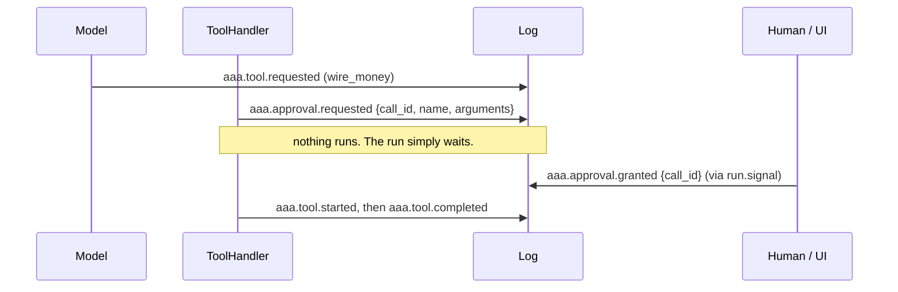

# Human approval

Mark a tool `requires_approval=True` and the call will not run until someone approves it. The check lives in
`ToolHandler`, **outside the model**: no prompt can talk its way past it.

```python
--8<-- "examples/tool_approval.py"
```

```text
waiting for approval of: wire_money {'amount': 250, 'to': 'ACME'}
sent $250 to ACME
```

## The protocol



| Event | Payload | Who emits it |
|---|---|---|
| `aaa.approval.requested` | `call_id`, `name`, `arguments` | `ToolHandler`, automatically |
| `aaa.approval.granted` | `call_id` | you: `await run.signal("aaa.approval.granted", {"call_id": ...})` |
| `aaa.approval.denied` | `call_id`, optional `reason` | you |

A **denial** becomes a `tool.failed` with `error.type == "ApprovalDenied"` and your reason, which the model reads and can
react to (explain, choose another route, give up).

## Things worth knowing

- **Waiting is free and durable.** A pending approval is just events in the log. The run can wait hours, survive
  restarts, and be approved from a different process or machine.
- **Approve the call, not the run.** Each approval names a `call_id`, and the `arguments` you reviewed are in the
  request event; the tool runs with exactly those arguments.
- **Duplicates are harmless.** Granting twice, or granting after the call already finished, does nothing.
- **A run deadline still applies.** Use `Budget(deadline_s=...)` to bound how long an unattended approval may block.
- **Finding pending approvals** across runs: scan for runs with an `aaa.approval.requested` and no matching result, or
  subscribe a handler to `aaa.approval.requested` that posts to Slack, a ticket queue or your UI.

```python
async def notify(event):  # a handler that pings a human
    await slack.post(
        f"Approve {event.data['name']}({event.data['arguments']}) for run {event.run_id}?"
    )


engine.subscribe(
    "aaa.approval.requested", notify, group="acme.notify"
)  # one notifier per cluster, not per worker
```

!!! danger "Authorization is yours"
    Anything that can append an `aaa.approval.granted` event to a run's stream can approve a call. AAA does not
    authenticate the sender, because signals are plain events. Put an authorization check in whatever service exposes
    "approve" to people, and restrict who has write access to the event store. See [Security](../operations/security.md).

Approval composes with the [execution guard](tool-guard.md): an approved call is still an exclusive, numbered attempt.
